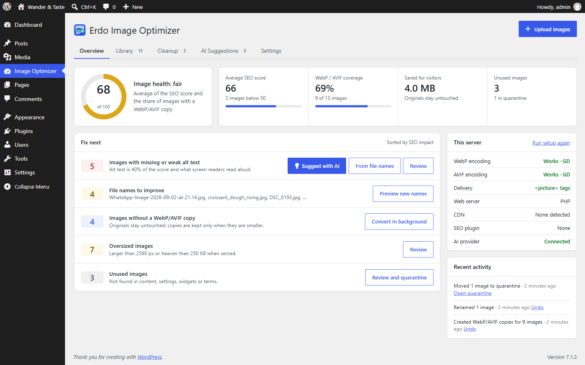
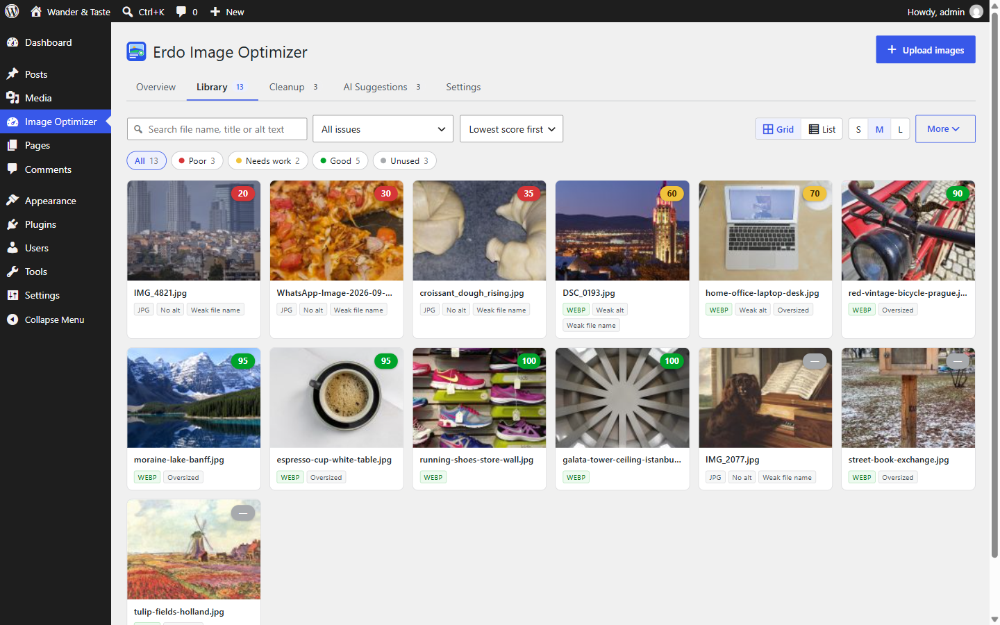
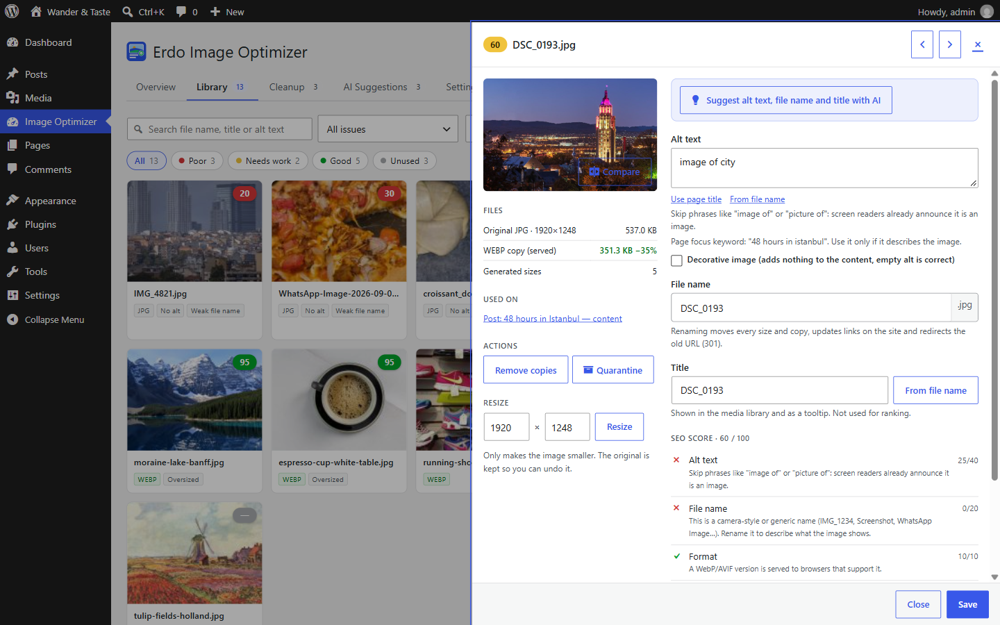
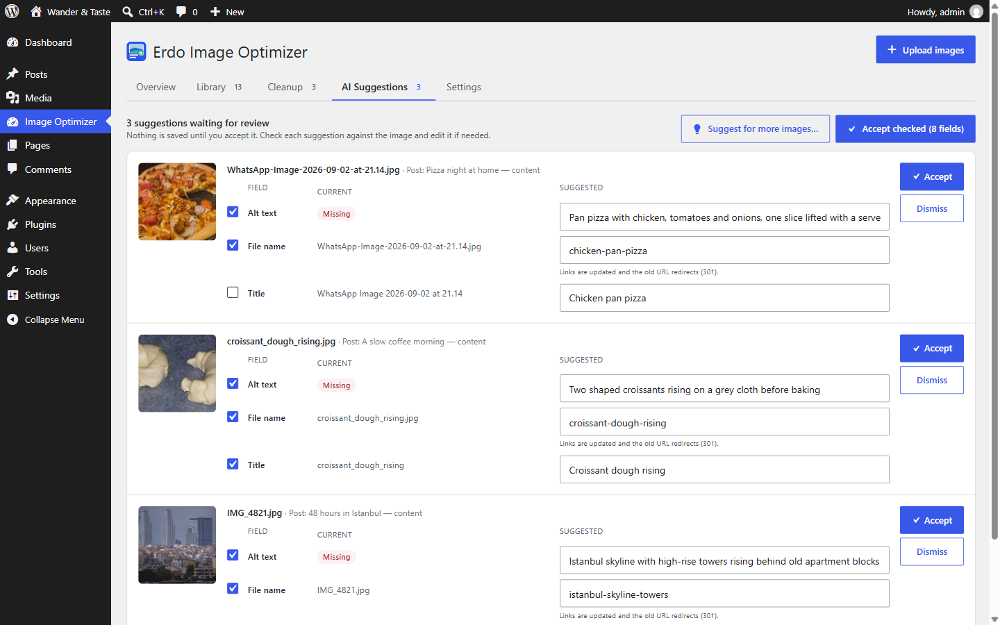
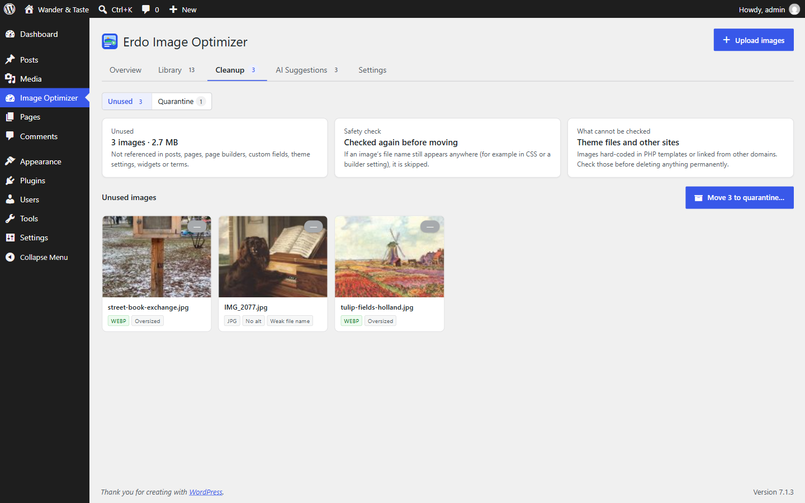
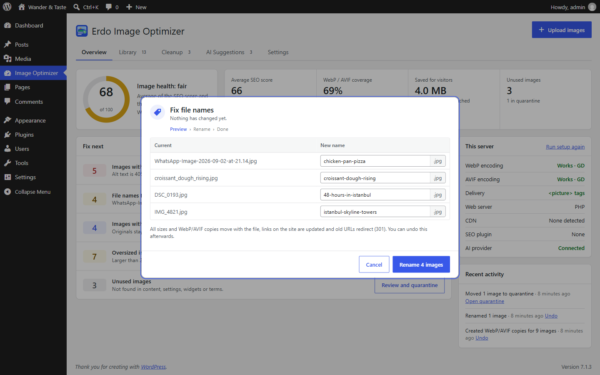
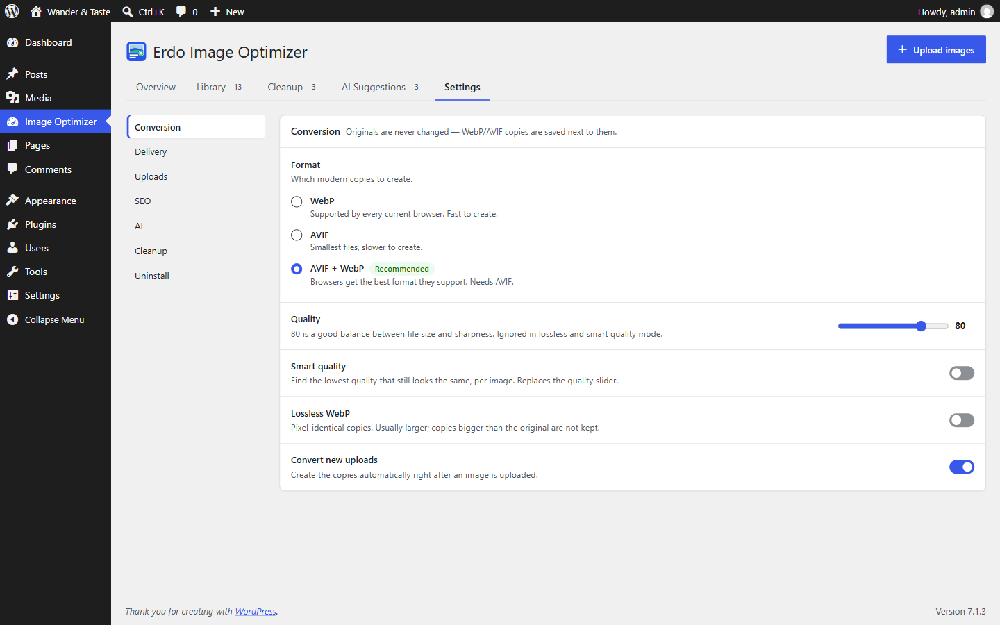

<p align="center">
  
</p>

<h1 align="center">Erdo Image Optimizer</h1>

<p align="center">
  <b>Image SEO for WordPress</b>: a 0–100 score for every image, AI alt text with your own provider key, safe renaming with redirects, unused-media quarantine and WebP/AVIF copies that never touch your originals.
</p>

<p align="center">
  <a href="https://wordpress.org/plugins/erdo-image-optimizer/"></a>
  <a href="https://wordpress.org/plugins/erdo-image-optimizer/"></a>
  <a href="https://wordpress.org/plugins/erdo-image-optimizer/"></a>
  
  
  
</p>

<p align="center">
  <a href="https://wordpress.org/plugins/erdo-image-optimizer/">WordPress.org</a> ·
  <a href="https://wordpress.org/plugins/erdo-image-optimizer/#developers">Changelog</a> ·
  <a href="#installation">Installation</a> ·
  <a href="https://github.com/erdincBulat/erdo-image-optimizer/issues">Report a bug</a>
</p>

---

Most image plugins stop at compression. Erdo looks at what search engines and screen readers see: the alt text, the file name, the format, the size and the page an image sits on. It scores every image, puts the fixes with the most impact at the top, and gives you tools that are safe to use on a live site. Every change shows a preview first, and almost everything can be undone.

<p align="center"></p>

## Screenshots

| Library | Image detail |
|---|---|
|  |  |

| AI suggestions | Cleanup |
|---|---|
|  |  |

| Fix file names | Settings |
|---|---|
|  |  |

## Features

**Image SEO score (0–100)**
- Alt text 40, file name 20, format 10, file size 10, dimensions 5, context 15.
- Alt text is checked for quality, not just presence: file-name-like text, "image of…", keyword lists and very long text lose points. Decorative images pass with an empty alt.
- Context means the image appears on a published, indexable page (Yoast SEO and Rank Math noindex respected). Focus keywords from Yoast, Rank Math, SEOPress and AIOSEO are used as hints.
- Filter by issue, sort by score, export the report as CSV.

**AI alt text with your own key (WordPress 7.0+)**
- Built on the WordPress AI Client. Connect Anthropic, Google or OpenAI under *Settings > Connectors*; the plugin never stores or sees the key.
- One request per image returns alt text, file name, title and caption, using the page the image is on, the text around it and the focus keyword.
- Suggestions wait for review and are accepted field by field or in bulk.

**Safe renaming**
- Every size, the pre-scaled original, edit backups and WebP/AVIF copies move together.
- Links are rewritten in content, page builder data, custom fields and options, including serialized and JSON data.
- Old URLs redirect (301). Undo per image or per batch.
- "Fix file names" replaces camera names (`IMG_4821.jpg`) with a descriptive one taken from the AI suggestion, the alt text or the page the image is on. You can edit each name in the preview.

**Unused media with quarantine**
- A usage index covers content, featured images, galleries, page builders, ACF, WooCommerce galleries, theme settings, widgets and term images.
- Unused images move to a quarantine folder instead of being deleted, and come back with one click. Permanent deletion is a separate step.

**WebP and AVIF next to the original**
- `photo.jpg.webp` and `photo.jpg.avif` are written for the main file and every size. The original is never modified, and a copy is kept only if it is smaller.
- Delivery with `<picture>` tags (works behind any CDN or page cache) or an Apache `.htaccess` rewrite. An nginx snippet is included.
- Server support is measured with a real test encode. Lossless WebP, smart quality and animated GIFs (Imagick) are supported.

**Also included:** first-run setup with recommended settings, an activity log with undo, image sitemap in the core sitemap, clean file names on upload, reversible resize, WP-CLI, REST endpoints, a dashboard widget and a repair tool for images converted by 2.x.

**What it does not do:** it does not compress or overwrite originals, lazy-load images (WordPress already does), offer a CDN, or run a server of its own.

## Installation

```
wp plugin install erdo-image-optimizer --activate
```

Or download it from [WordPress.org](https://wordpress.org/plugins/erdo-image-optimizer/), upload the `erdo-image-optimizer` folder to `/wp-content/plugins/` and activate it. Open **Image Optimizer** in the admin menu; the setup tests your server and recommends settings.

**Requirements:** WordPress 6.5+, PHP 7.4+. AVIF needs GD or Imagick with AVIF support (tested on your server during setup). AI suggestions need WordPress 7.0+ and an account with an AI provider.

## Try it instantly

[](https://playground.wordpress.net/?blueprint-url=https://raw.githubusercontent.com/erdincBulat/erdo-image-optimizer/main/assets/blueprints/blueprint.json)

Runs in your browser with demo posts and public-domain images; no server or account needed.

## WP-CLI

```
wp erdo audit [--format=csv] [--status=red]
wp erdo convert [--id=<id>] [--year=<year>] [--limit=<n>] [--dry-run]
wp erdo restore --id=<id>
wp erdo rename <id>... [--name=<name>] [--pattern=<pattern>] [--keyword=<kw>] [--all] [--dry-run]
wp erdo rename --undo=<batch>
wp erdo index [--status]
wp erdo unused
wp erdo quarantine list|add-unused|restore|purge [--id=<id>]
wp erdo migrate [--dry-run]
wp erdo stats
wp erdo clean-cache
```

## REST API

| Endpoint | Description |
|---|---|
| `GET /wp-json/erdo/v1/stats` | Library statistics: images, images with WebP/AVIF copies, coverage, bytes saved, format |
| `GET /wp-json/erdo/v1/audit` | SEO audit results, 50 per page (`?page=`, `?status=`) |
| `POST /wp-json/erdo/v1/ai/{id}/suggest\|accept\|reject` | AI suggestions for one image (needs `edit_post` on it) |

## Contributing

Issues and pull requests are welcome; see [CONTRIBUTING.md](.github/CONTRIBUTING.md). This repository mirrors the plugin on WordPress.org.

- `trunk/` is the development copy (the only folder to edit).
- `tags/` holds frozen snapshots of past releases.
- `assets/` holds the WordPress.org listing assets (icon, banners, screenshots, Live Preview blueprint).
- `tests/` holds behavioural suites that run inside a local WordPress site (`tests/run.ps1`).

If Erdo is useful to you, a star here or a [review on WordPress.org](https://wordpress.org/support/plugin/erdo-image-optimizer/reviews/#new-post) helps other people find it.

## Security

Every AJAX handler checks a nonce and the `manage_options` capability; REST routes check capabilities per image. File operations are limited to the uploads folder. If you find a security issue, please contact the author privately instead of opening a public issue.

## License

GPLv2 or later; see [LICENSE.txt](LICENSE.txt).
